<!-- Подпись под ником можно менять в строке <samp> ниже. -->

  <picture><source media="(prefers-color-scheme: dark)" srcset="assets/name-v2-dark.svg"><source media="(prefers-color-scheme: light)" srcset="assets/name-v2-light.svg"></picture> 
  <samp>infosec // dev</samp> 
  <picture><source media="(prefers-color-scheme: dark)" srcset="assets/planet-v3-dark.svg"><source media="(prefers-color-scheme: light)" srcset="assets/planet-v3-light.svg"></picture> 
  <a href="https://github.com/sk1fony?tab=repositories"><picture><source media="(prefers-color-scheme: dark)" srcset="assets/repositories-v2-dark.svg"><source media="(prefers-color-scheme: light)" srcset="assets/repositories-v2-light.svg"></picture></a>
  <a href="https://github.com/sk1fony?tab=stars"><picture><source media="(prefers-color-scheme: dark)" srcset="assets/stars-v2-dark.svg"><source media="(prefers-color-scheme: light)" srcset="assets/stars-v2-light.svg"></picture></a>

